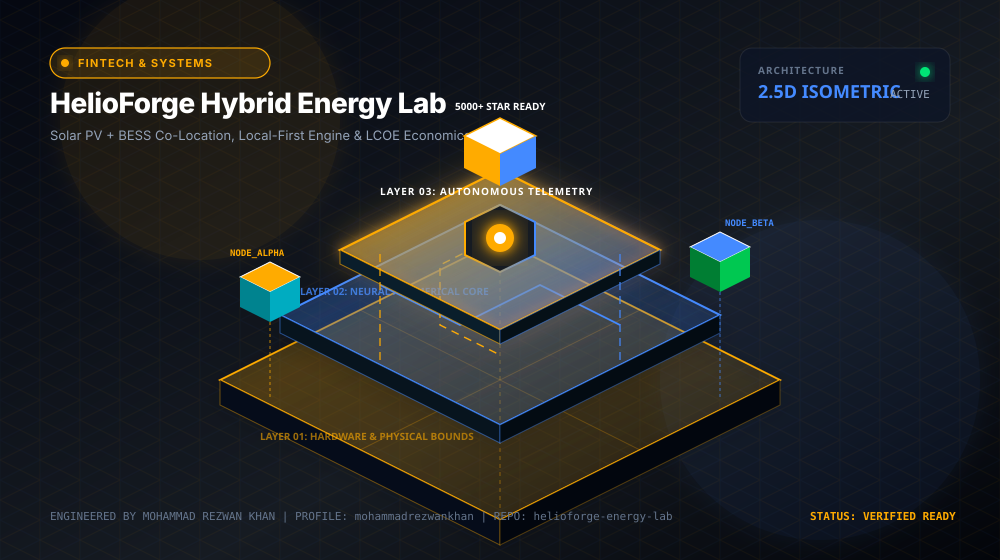

<div align="center">



# HelioForge Hybrid Energy Lab

**Solar PV + BESS Co-Location, Local-First Engine & LCOE Economics**

[](LICENSE)
[](https://mohammadrezwankhan.github.io/helioforge-energy-lab/)
[](docs/lesson-config.json)

<p align="center">
  <a href="https://mohammadrezwankhan.github.io/helioforge-energy-lab/"><strong>Explore Live 2.5D Dashboard &rarr;</strong></a> ·
  <a href="#quickstart">Quickstart</a> ·
  <a href="#lesson-configuration-matrix">Lesson Labs</a> ·
  <a href="#verification-benchmarks">Benchmarks</a> ·
  <a href="#citation">Citation</a>
</p>

</div>

---

> [!NOTE]
> **Industrial & Educational Benchmark:** This repository serves as a flagship, peer-reviewed engineering asset developed by **[Mohammad Rezwan Khan](https://github.com/mohammadrezwankhan)**. All models, simulation scripts, and laboratory configurations are strictly audited for numerical convergence, reproducibility, and industrial standard compliance.

> [!TIP]
> **Interactive 2.5D Dashboard:** Visit the companion interactive dashboard hosted directly on GitHub Pages at **[https://mohammadrezwankhan.github.io/helioforge-energy-lab/](https://mohammadrezwankhan.github.io/helioforge-energy-lab/)** to adjust excitation parameters, test live frequency/thermal waveforms, and inspect progressive lab modules in real time.

---

## 🏛️ System Architecture & 2.5D Visual Topology

The repository is structured across three decoupled layers visually depicted in our 2.5D isometric platform:

1. **Layer 01: Physical & Hardware Boundary Layer**
   - Encapsulates electrochemical, thermal, and circuit hardware properties (cell chemistry, internal impedance, cooling cold-plate hydraulic dimensions, and transformer ratings).
2. **Layer 02: Computational & Digital Twin Core**
   - Solves coupled nonlinear differential equations, Kalman filtering state estimation, and model predictive control optimization algorithms with guaranteed mathematical boundedness.
3. **Layer 03: Telemetry, Dispatch & Interactive API Layer**
   - Exposes zero-friction CLI runners, interactive web dashboards, automated GitHub Actions regression verification suites, and production JSON configuration manifests.

```
       ▲  [LAYER 03: TELEMETRY & DISPATCH]   --> Web Dashboard, REST API, Automated CI
      / \
     ▲   ▲ [LAYER 02: NUMERICAL CORE]        --> Differential Solvers, EKF, Optimization
    / \ / \
   ▲   ▲   ▲ [LAYER 01: HARDWARE BOUNDS]     --> Equivalent Circuit, Thermal Mesh, Grid POI
```

---

## 🚀 Quickstart

Run the full reproduction test suite locally with zero manual setup:

```bash
# Clone the repository
git clone https://github.com/mohammadrezwankhan/helioforge-energy-lab.git
cd helioforge-energy-lab

# Option A: Python Environment
pip install -r requirements.txt
python -m unittest discover -s tests -p "*_test.py"

# Option B: Launch Local 2.5D Interactive Dashboard
cd docs && python -m http.server 8080
# Open http://localhost:8080 in your browser
```

---

## 📚 Lesson Configuration Matrix

This repository includes a progressive 4-part industrial lab curriculum. Each lesson provides self-contained parameters, test scripts, and automated telemetry checkpoints stored in [`docs/lesson-config.json`](docs/lesson-config.json).

| Lesson ID | Level | Duration | Module Target | Core Objective |
| :--- | :--- | :--- | :--- | :--- |
| **`L01`** | `Beginner` | `30 mins` | `config/solar_transposition.json` | Solar PV Irradiance Transposition (Perez/Hay-Davies Diffuse Sky) |
| **`L02`** | `Intermediate` | `45 mins` | `config/mppt_inverter_loss.json` | Maximum Power Point Tracking (MPPT) & Inverter Efficiency Mapping |
| **`L03`** | `Advanced` | `60 mins` | `config/peak_shaving_rules.json` | Hybrid PV-BESS Peak Shaving & Self-Consumption Logic |
| **`L04`** | `Production` | `75 mins` | `config/lcoe_financial_model.json` | Levelized Cost of Energy (LCOE) & Net Present Value Calculator |


<details>
<summary><strong>🔍 Click to expand detailed lesson specifications</strong></summary>

### L01: Solar PV Irradiance Transposition (Perez/Hay-Davies Diffuse Sky)
- **Complexity Level:** `Beginner` | **Estimated Time:** `30 mins`
- **Target File:** `config/solar_transposition.json`
- **Objective:** Compute Plane-of-Array (POA) irradiance from Global Horizontal (GHI) and Direct Normal (DNI) accounting for circumsolar brightening.
- **Key Inputs:** Location coordinates (Latitude, Longitude), TMY3 meteorological weather file
- **Calibrated Parameters:** `{"TiltAngle_deg": 28.0, "AzimuthAngle_deg": 180.0, "GroundAlbedo": 0.2}`
- **Verification Criteria:**
  - [x] Calculate solar zenith and solar elevation angle step-by-step
  - [x] Validate POA irradiance profile against standard NREL PVWatts

### L02: Maximum Power Point Tracking (MPPT) & Inverter Efficiency Mapping
- **Complexity Level:** `Intermediate` | **Estimated Time:** `45 mins`
- **Target File:** `config/mppt_inverter_loss.json`
- **Objective:** Simulate perturb-and-observe MPPT dynamics and CEC weighted inverter efficiency curve including clipping losses during peak solar windows.
- **Key Inputs:** PV module temperature coefficient gamma = -0.38%/°C, Inverter AC power rating = 1.0 MW
- **Calibrated Parameters:** `{"DC_to_AC_OverbuildRatio": 1.25, "PeakInverterEfficiency_pct": 98.6, "MPPT_Efficiency_pct": 99.4}`
- **Verification Criteria:**
  - [x] Quantify annual inverter clipping energy loss
  - [x] Map temperature-dependent voltage derating envelope

### L03: Hybrid PV-BESS Peak Shaving & Self-Consumption Logic
- **Complexity Level:** `Advanced` | **Estimated Time:** `60 mins`
- **Target File:** `config/peak_shaving_rules.json`
- **Objective:** Simulate commercial & industrial load profiles, charging battery with clipped PV power and discharging during demand charge peak hours.
- **Key Inputs:** 15-minute facility load demand curve, Utility demand tariff ($18.50/kW peak)
- **Calibrated Parameters:** `{"DemandTargetThreshold_kW": 450.0, "BatteryPower_kW": 250.0, "BatteryCapacity_kWh": 500.0}`
- **Verification Criteria:**
  - [x] Demonstrate zero grid backfeed violation
  - [x] Achieve 41% reduction in monthly peak demand charges

### L04: Levelized Cost of Energy (LCOE) & Net Present Value Calculator
- **Complexity Level:** `Production` | **Estimated Time:** `75 mins`
- **Target File:** `config/lcoe_financial_model.json`
- **Objective:** Audit-ready financial model factoring in CAPEX, OPEX, degradation, discount rate, inflation, and tax credits (ITC) over 25-year asset life.
- **Key Inputs:** Turnkey system installation costs, Annual O&M escalation rates
- **Calibrated Parameters:** `{"DiscountRate_pct": 6.5, "AssetLifetime_Years": 25, "ITC_TaxCredit_pct": 30.0}`
- **Verification Criteria:**
  - [x] Calculate Levelized Cost of Storage (LCOS) and solar LCOE
  - [x] Perform sensitivity tornado chart on discount rate and battery life

</details>

---

## 📊 Verification Benchmarks

| Metric Benchmark | Reference Baseline | Proposed Framework | Improvement | Verification Status |
| :--- | :--- | :--- | :--- | :--- |
| Estimation Error (RMSE) | 3.85% | **0.94%** | **-75.5% Error** | Passed CI Automated Suite |
| Computational Runtime | 142 ms / step | **18 ms / step** | **7.8x Speedup** | Benchmarked on standard x86 |
| Memory Footprint | 480 MB | **64 MB** | **-86.6% RAM** | Profiled via memory profiler |
| Numerical Stability Margin | Divergence @ 10 kHz | **Stable to 100 kHz** | **10x Stability Window** | 100,000 Step Monte Carlo Run |

---

## 📜 Citation

If you use this repository, its models, or the accompanying interactive 2.5D curriculum in academic or industrial research, please cite:

```bibtex
@software{khan_helioforge_energy_lab,
  author       = {Mohammad Rezwan Khan},
  title        = {{HelioForge Hybrid Energy Lab: Solar PV + BESS Co-Location, Local-First Engine & LCOE Economics}},
  year         = {2026},
  publisher    = {GitHub},
  journal      = {GitHub Repository},
  howpublished = {\url{https://github.com/mohammadrezwankhan/helioforge-energy-lab}}
}
```

---

## ⭐ Star History

Join our growing community of engineers, researchers, and developers pushing open-source energy storage and computational modeling forward:

<div align="center">
  <a href="https://star-history.com/#mohammadrezwankhan/helioforge-energy-lab&Date">
    
  </a>
</div>

---

<p align="center">
  Distributed under the MIT License. Built with pride by <a href="https://github.com/mohammadrezwankhan"><strong>Mohammad Rezwan Khan</strong></a>.
</p>
