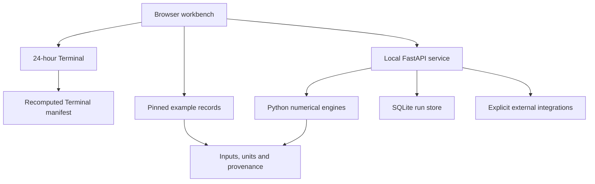

# Architecture and calculation boundaries

Reviewed source: `fb42eb4d9b0c87e692710e8e867ab5190ea831a7` · 2026-11-19. The application combines a browser workbench, a local FastAPI service and packaged numerical examples. Its teaching companion in `docs/index.html` is independently implemented. Preserve the distinction between an illustrative interface and the engine that supplies its numbers.

## Five entry surfaces

| Surface | Execution and data | Boundary |
|---|---|---|
| Packaged / hosted workbench | Bundled Python examples, 36 architecture descriptions, 36 lessons and 59 study examples; deferred hosted datasets have byte counts and SHA-256 checks | Advanced edited inputs require the local service; bundled results attach only to matching presets |
| Browser Terminal | Native TypeScript 24-hour PV / battery / grid recurrence, parameter sweeps, local sensitivities and manifest recomputation | Independent of the Python hybrid dispatch and storage optimizer; no API call is needed for this bounded model |
| Local Python app | FastAPI, Pydantic request models, NumPy/SciPy engines, SQLite saved runs; launcher binds `127.0.0.1` | A single-user local workbench, not a production multi-user service |
| Opt-in external integrations | Weather, market/regulatory feeds, allowlisted Modbus reads and external council protocol | Configuration and consent are prerequisites; successful access and trustworthy evidence require separate observations |
| Documentation teaching companion | Four configured modules and its own browser illustration | Its fixed battery-kW contribution has no SOC inventory, charging policy or storage optimization |

Sources: [apps/web/src/terminal-engine.ts](https://github.com/mohammadrezwankhan/helioforge-energy-lab/blob/fb42eb4d9b0c87e692710e8e867ab5190ea831a7/apps/web/src/terminal-engine.ts), [apps/web/src/deferred-data.ts](https://github.com/mohammadrezwankhan/helioforge-energy-lab/blob/fb42eb4d9b0c87e692710e8e867ab5190ea831a7/apps/web/src/deferred-data.ts), [apps/api/helioforge/main.py](https://github.com/mohammadrezwankhan/helioforge-energy-lab/blob/fb42eb4d9b0c87e692710e8e867ab5190ea831a7/apps/api/helioforge/main.py), [launch.py](https://github.com/mohammadrezwankhan/helioforge-energy-lab/blob/fb42eb4d9b0c87e692710e8e867ab5190ea831a7/launch.py), [docs/index.html](https://github.com/mohammadrezwankhan/helioforge-energy-lab/blob/fb42eb4d9b0c87e692710e8e867ab5190ea831a7/docs/index.html), [docs/lesson-config.json](https://github.com/mohammadrezwankhan/helioforge-energy-lab/blob/fb42eb4d9b0c87e692710e8e867ab5190ea831a7/docs/lesson-config.json).

The diagram shows computation and evidence relationships, not deployment trust. It does not connect the separate teaching companion to an engine it never calls.

## Repository map

| Path | Responsibility |
|---|---|
| `apps/api/helioforge/engines/storage.py` | Short-horizon MILP, cyclic SOC and independently solved no-battery comparator |
| `apps/api/helioforge/engines/hybrid.py`, `hybrid.py` | Greedy hourly topology/control applicability and hybrid energy balance |
| `apps/api/helioforge/engines/terminal.py` | Python reference contract for the browser Terminal recurrence and comparisons |
| `apps/api/helioforge/engines/finance.py`, `forecast.py`, `research.py` | Project/PV finance, seeded scenarios, drift, Weibull and carbon screens |
| `apps/api/helioforge/studies.py`, seven `engines/*_studies.py` modules | Registry and envelope for 59 independently scoped studies |
| `apps/api/helioforge/provenance.py`, `store.py` | Domain-separated source/data/input digests and local saved runs |
| `apps/api/helioforge/council*.py`, `integrations*.py` | Deterministic checklist, external protocol and evidence/connector boundaries |
| `apps/web/src` | Ordered `HF` namespace scripts, accessible DOM construction, controls, exports and illustrations |
| `scripts/compile-web.mjs`, `build-web.mjs`, `hosted-data.mjs` | Strict compilation, standalone build and deferred hosted assets |
| `apps/web/dist`, `HelioForge-Preview.html` | Packaged generated runtime artifacts; edit canonical source and rebuild |
| `docs`, `assets`, `.github/workflows/deploy-dashboard.yml` | Established teaching/documentation publication route |

The module map is grounded in [apps/api/helioforge/studies.py:25–101](https://github.com/mohammadrezwankhan/helioforge-energy-lab/blob/fb42eb4d9b0c87e692710e8e867ab5190ea831a7/apps/api/helioforge/studies.py#L25-L101), [apps/web/tsconfig.json](https://github.com/mohammadrezwankhan/helioforge-energy-lab/blob/fb42eb4d9b0c87e692710e8e867ab5190ea831a7/apps/web/tsconfig.json), [scripts/compile-web.mjs](https://github.com/mohammadrezwankhan/helioforge-energy-lab/blob/fb42eb4d9b0c87e692710e8e867ab5190ea831a7/scripts/compile-web.mjs), [scripts/build-web.mjs](https://github.com/mohammadrezwankhan/helioforge-energy-lab/blob/fb42eb4d9b0c87e692710e8e867ab5190ea831a7/scripts/build-web.mjs), [.github/workflows/deploy-dashboard.yml](https://github.com/mohammadrezwankhan/helioforge-energy-lab/blob/fb42eb4d9b0c87e692710e8e867ab5190ea831a7/.github/workflows/deploy-dashboard.yml).

## Numerical contracts stay distinct

The storage MILP minimizes a period objective with fixed initial and terminal SOC. The hybrid engine follows a deterministic supply priority and allows end-of-period stored energy to differ from its initial value. Terminal has its own load/PV shapes, 11 camelCase input fields and a free terminal SOC. The `storage-annual` study uses a tariff policy over 8760 hours, whereas `storage-annualopt` solves a different full-year MILP. A cheap result from one is not an interchangeable optimum or annual saving from another. [apps/api/helioforge/engines/storage.py](https://github.com/mohammadrezwankhan/helioforge-energy-lab/blob/fb42eb4d9b0c87e692710e8e867ab5190ea831a7/apps/api/helioforge/engines/storage.py), [apps/api/helioforge/engines/hybrid.py](https://github.com/mohammadrezwankhan/helioforge-energy-lab/blob/fb42eb4d9b0c87e692710e8e867ab5190ea831a7/apps/api/helioforge/engines/hybrid.py), [apps/api/helioforge/engines/terminal.py](https://github.com/mohammadrezwankhan/helioforge-energy-lab/blob/fb42eb4d9b0c87e692710e8e867ab5190ea831a7/apps/api/helioforge/engines/terminal.py), [apps/api/helioforge/engines/toolkit_studies.py](https://github.com/mohammadrezwankhan/helioforge-energy-lab/blob/fb42eb4d9b0c87e692710e8e867ab5190ea831a7/apps/api/helioforge/engines/toolkit_studies.py), [apps/api/helioforge/engines/planning_studies.py](https://github.com/mohammadrezwankhan/helioforge-energy-lab/blob/fb42eb4d9b0c87e692710e8e867ab5190ea831a7/apps/api/helioforge/engines/planning_studies.py).

There are **19 runnable screening architectures and 17 study-only architectures**. Applicability checks also constrain scenarios. The 285 bundled numerical architecture/scenario examples do not turn every catalogue diagram into an executable dynamic model. The 59 research studies are additional scoped implementations; their labels do not imply field qualification. [docs/HYBRID_COVERAGE.md](https://github.com/mohammadrezwankhan/helioforge-energy-lab/blob/fb42eb4d9b0c87e692710e8e867ab5190ea831a7/docs/HYBRID_COVERAGE.md), [apps/api/helioforge/hybrid.py](https://github.com/mohammadrezwankhan/helioforge-energy-lab/blob/fb42eb4d9b0c87e692710e8e867ab5190ea831a7/apps/api/helioforge/hybrid.py), [apps/api/helioforge/studies.py](https://github.com/mohammadrezwankhan/helioforge-energy-lab/blob/fb42eb4d9b0c87e692710e8e867ab5190ea831a7/apps/api/helioforge/studies.py).

## State, imports and stale responses

Hybrid controls maintain a revision counter. Changing inputs clears the run reference and disables current-result actions; asynchronous responses and file imports must still match that revision. Study edits hide old output until a new run succeeds; imports have their own generation guard. Terminal similarly separates a completed result from a draft and guards asynchronous operations. These are state-consistency mechanisms, not cancellation of all server-side work. [apps/web/src/hybrid-controller.ts](https://github.com/mohammadrezwankhan/helioforge-energy-lab/blob/fb42eb4d9b0c87e692710e8e867ab5190ea831a7/apps/web/src/hybrid-controller.ts), [apps/web/src/roadmap.ts](https://github.com/mohammadrezwankhan/helioforge-energy-lab/blob/fb42eb4d9b0c87e692710e8e867ab5190ea831a7/apps/web/src/roadmap.ts), [apps/web/src/terminal-ui.ts](https://github.com/mohammadrezwankhan/helioforge-energy-lab/blob/fb42eb4d9b0c87e692710e8e867ab5190ea831a7/apps/web/src/terminal-ui.ts).

The browser storage key `hf-workspace-v3` currently holds schema **`helioforge.workspace.v2`**. It stores inputs, lesson selection, saved setups and API run references, not the corresponding numerical result objects. A supported v1 record is migrated through preview and confirmation; the previous raw cache is written to a recovery backup before replacement. API-run recovery needs the same SQLite database. Lesson mastery and simple lesson progress use separate keys; Terminal state is a separate in-memory session. [apps/web/src/champion-core.ts](https://github.com/mohammadrezwankhan/helioforge-energy-lab/blob/fb42eb4d9b0c87e692710e8e867ab5190ea831a7/apps/web/src/champion-core.ts), [apps/web/src/champion-controller.ts](https://github.com/mohammadrezwankhan/helioforge-energy-lab/blob/fb42eb4d9b0c87e692710e8e867ab5190ea831a7/apps/web/src/champion-controller.ts), [apps/web/src/completion-ui.ts](https://github.com/mohammadrezwankhan/helioforge-energy-lab/blob/fb42eb4d9b0c87e692710e8e867ab5190ea831a7/apps/web/src/completion-ui.ts), [apps/web/src/terminal-ui.ts](https://github.com/mohammadrezwankhan/helioforge-energy-lab/blob/fb42eb4d9b0c87e692710e8e867ab5190ea831a7/apps/web/src/terminal-ui.ts).

## Evidence and trust

`source_revision` inside a numerical result is a domain-separated SHA-256 over selected source files, not the repository's Git commit ID. Effective model inputs, saved request inputs and dataset identity can have different digests. A result envelope records these distinctions; exports carry them forward. `evidence_sha256` covers the pre-digest study result JSON. The built-in `signEvidence` operation generates an ephemeral local P-256 key. `verifyEvidence` checks the canonical payload digest and each ECDSA/SHA-256 signature for 1–20 distinct valid public keys, rejecting a supplied private JWK `d` member. Verification does not determine the accepted keys’ lifecycle or identify a person or approving institution. [apps/web/src/evidence.ts:12–46](https://github.com/mohammadrezwankhan/helioforge-energy-lab/blob/fb42eb4d9b0c87e692710e8e867ab5190ea831a7/apps/web/src/evidence.ts#L12-L46) [apps/api/helioforge/provenance.py](https://github.com/mohammadrezwankhan/helioforge-energy-lab/blob/fb42eb4d9b0c87e692710e8e867ab5190ea831a7/apps/api/helioforge/provenance.py), [apps/api/helioforge/studies.py:71–99](https://github.com/mohammadrezwankhan/helioforge-energy-lab/blob/fb42eb4d9b0c87e692710e8e867ab5190ea831a7/apps/api/helioforge/studies.py#L71-L99), [apps/web/src/result-provenance.ts](https://github.com/mohammadrezwankhan/helioforge-energy-lab/blob/fb42eb4d9b0c87e692710e8e867ab5190ea831a7/apps/web/src/result-provenance.ts), [apps/web/src/evidence.ts](https://github.com/mohammadrezwankhan/helioforge-energy-lab/blob/fb42eb4d9b0c87e692710e8e867ab5190ea831a7/apps/web/src/evidence.ts).

Package/CFF version `2.0.0`, API health `0.3.0`, catalogue version and per-model/schema versions are distinct existing identities. This documentation update does not synchronize or release them. See [release playbook](../maintainer/CI_CD_AND_RELEASE_PLAYBOOK.md).
